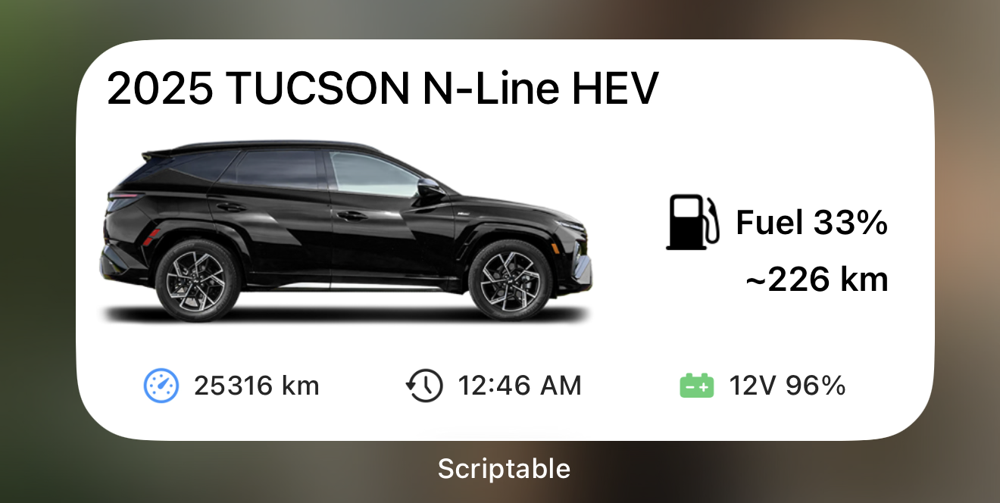
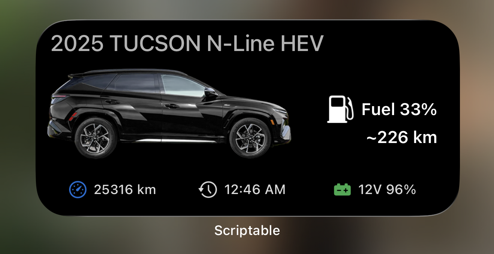
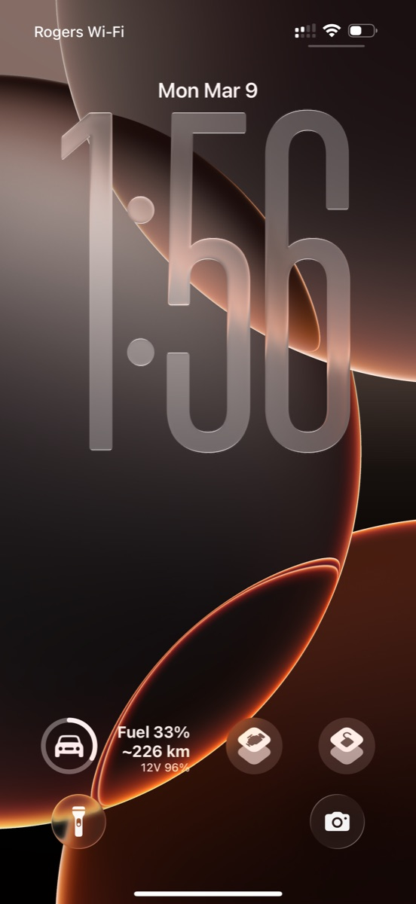

# Widgets

Bluelocke supports both Home Screen and Lock Screen widgets, so you can check your vehicle at a glance without opening the full app.

## Widget Appearance (White and Dark)

You can pick how widgets look in app settings:

- `White`
- `Dark`
- `System` (follows iPhone appearance)

The screenshots below show the white and dark widget styles:

### White Mode

### Dark Mode

## Home Screen Widgets

Bluelocke currently supports:

- `Medium` widget

### Medium Widget

The medium widget shows:

- Vehicle name at the top
- Vehicle image in the center
- Battery or fuel level, depending on your car
- Estimated distance you can drive
- Bottom summary row:
  - Odometer (mileage)
  - Last updated time
  - 12V battery level

For petrol and non-plug-in hybrid cars, the widget shows:

- `Fuel x%` in larger text
- `~ range` in larger text below it

## Lock Screen Widgets

Choose one of these Lock Screen styles:

- `Inline`: single-line summary
- `Circular`: a small round display
- `Rectangular`: compact detail view

### Lock Screen Example

  

<strong>Layout:</strong> The left tile is the Scriptable widget. The two tiles on the right are shortcuts.

These are ideal when you only need a quick status check.

## What the Widget Info Means

Here is what each value represents in plain language:

- `Fuel % / Battery %`: How much fuel or battery charge is left.
- `Range`: Estimated distance left based on the latest vehicle data.
- `Odometer`: Total distance on the vehicle.
- `Last Updated`: When the car information was last updated.
- `12V`: Charge level of your car’s small 12V battery.
- `Charging Info` (electric and plug-in hybrid cars): Charging state and estimated completion time.

## When Widgets Update

Widgets show the last information Bluelocke received from your car. They update from time to time, so a change may not appear straight away.

You can change how often Bluelocke checks for new information under **Advanced Widget Settings**. Your iPhone needs an internet connection to get new information.
